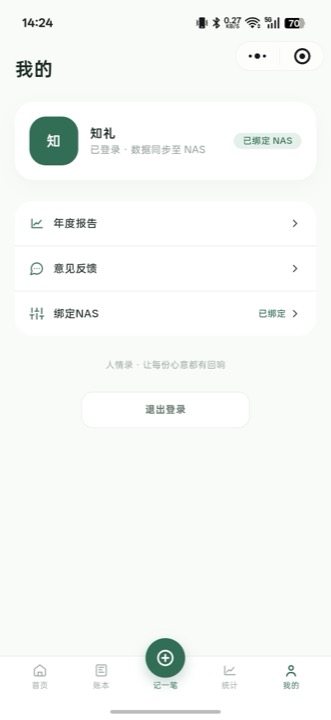

# 人情录

fnOS(飞牛OS)人情账本应用:记录婚礼、满月、生日、乔迁、升学等场合的礼金往来,让每一份心意有迹可循。

> 本仓库用于**应用介绍**与**版本发布**:从 [Releases](https://github.com/pdf-covert/gift-ledger/releases) 下载 `.fpk` 安装包,在飞牛OS 应用中心手动安装即可。

## 功能特性

- **记账简单**:「记一笔」收录入/支出,选关系、事由、日期,一键保存;随时查看、编辑、删除
- **AI 记账**:像聊天一样描述往来,AI 解析成记录、确认后批量入账(免费使用,在「设置 → AI 模型」配置自己的模型即可)
- **往来联系人**:按联系人聚合收支,结余一目了然,支持姓名搜索,该回多少心里有数
- **统计分析**:最近 6 个月收支趋势、支出事由分布,一眼看清
- **筛选查找**:按姓名/备注搜索,按事由、月份筛选,收支类型分页浏览
- **家人共用**:每位家人打开都是自己的独立账本,互不打扰;打开即用,无需注册登录
- **微信小程序**:绑定 NAS 后,出门在外用微信也能记账、查往来、看统计与年度报告(见下文)
- **备份还原**:账本一键导出为加密备份文件,可在任意一台装了本应用的设备导入恢复,换设备迁移方便
- **意见反馈**:应用「设置 → 意见反馈」或小程序「我的 → 意见反馈」,建议和问题直达开发者

## 安装

1. 在 [Releases](https://github.com/pdf-covert/gift-ledger/releases) 页找到最新版本
2. 根据飞牛OS 设备架构下载安装包:
   - `gift-ledger-x86-<版本>.fpk` —— x86_64(amd64)
   - `gift-ledger-arm-<版本>.fpk` —— ARM64
3. 打开飞牛OS **应用中心 → 手动安装**,选择下载的 `.fpk` 文件
4. 安装完成后从桌面进入「人情录」

> 桌面入口对所有用户可见,每位家人有独立的账本。

## 微信小程序(远程记账)

家里 NAS 记账,外面微信补记:在外出的路上用微信就能查看往来、记一笔、看统计与**年度报告**,所有改动实时写回家里的人情录。

**绑定步骤**(只需一次):

1. 在应用「设置 → 接口密钥」确认已生成密钥,点开「扫码绑定小程序」
2. 用微信**先扫左边的小程序码**打开「人情录」小程序
3. 在小程序「我的 → 绑定NAS」中**再扫右边的配置二维码**,地址与密钥自动填入(也可以手动输入)
4. 绑定成功即可在小程序里远程记账;删除记录时 NAS 中会同步删除
5. 应用端**更换密钥**后,小程序会立即提示失效并引导重新扫码/输入,重绑即恢复

## 数据与隐私

- 账本数据只保存在你自己的飞牛设备上,不上传云端;卸载应用前建议先在「设置」页导出备份
- 小程序绑定 NAS 后,远程记账的链路是「小程序 → 云端服务(仅中转)→ 你的 NAS(唯一存储)」,云端不留存账本数据;未绑定 NAS 时小程序里的记账数据暂存开发者云端,绑定后可一键同步回自己的 NAS
- 备份文件加密保存,可在任意一台装了本应用的设备上导入恢复
- 购买状态(限免/永久)保存在开发者云端,仅用于支持持续更新,与账本数据无关
- 意见反馈内容与联系方式保存在开发者云端,仅用于回复与改进应用

## 购买说明

所有记账功能目前均**免费使用**;新用户限免 30 天,到期后功能不受影响,仅显示提示。如愿支持应用持续更新,可在「设置 → 购买」购买永久版(¥19.9 一次性买断):微信扫码支付,支付成功自动开通。永久版仅限**当前设备**有效。

## 版本

见 [Releases](https://github.com/pdf-covert/gift-ledger/releases)。当前版本:见最新 Release。
